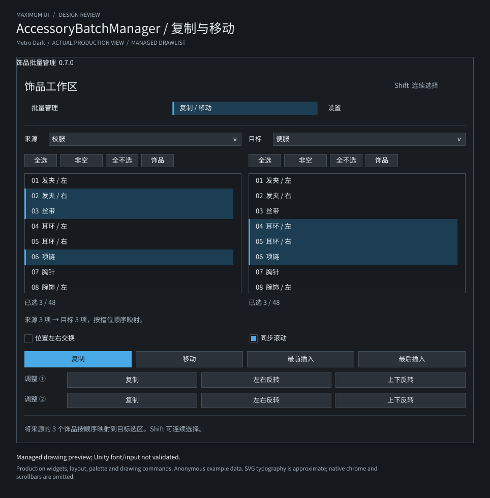
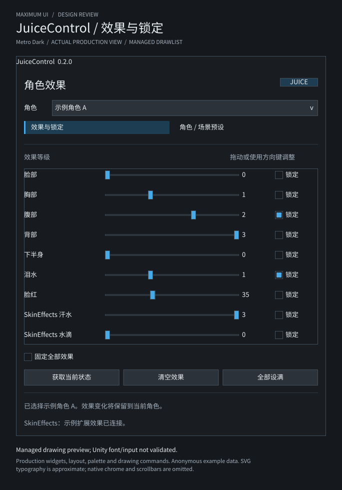

# MaximumUI managed drawing previews

This independent .NET 9 tool produces review images from the **real Gallery and the four production plugin editors**. It has no NuGet packages and is excluded from plugin deployment. All example characters, item names, presets and programs are anonymous in-memory fixtures; the exporter never reads uploaded files, cards, XML or game state.

The [GitHub Actions workflow](../../.github/workflows/ci.yml) runs this same entry point after building the solution. Its `maximumui-previews-…` artifact contains the SVGs and `preview-manifest.json`, which records each production source, viewport, layout-node count, drawing-command count and the number of virtual rows actually built.

| View | Export | Viewport |
| --- | --- | --- |
| Gallery Overview, Metro Dark | [Open preview](../../docs/maximumui-metro-dark-preview.svg) | 940 × 840 |
| Gallery Overview, Metro Light | [Open preview](../../docs/maximumui-metro-light-preview.svg) | 940 × 840 |
| JuiceControl effects and locks | [Open preview](../../docs/juicecontrol-effects-preview.svg) | 620 × 760 |
| JuiceControl character and scene presets | [Open preview](../../docs/juicecontrol-presets-preview.svg) | 620 × 760 |
| AccessoryBatchManager batch management | [Open preview](../../docs/accessory-batch-manager-batch-preview.svg) | 900 × 760 |
| AccessoryBatchManager copy and move | [Open preview](../../docs/accessory-batch-manager-copy-preview.svg) | 900 × 760 |
| ExpressionControl expression editor | [Open preview](../../docs/expressioncontrol-expressions-preview.svg) | 1080 × 760 |
| ExpressionControl program rules | [Open preview](../../docs/expressioncontrol-program-preview.svg) | 1080 × 760 |
| ClothingCompression deformation editor | [Open preview](../../docs/clothingcompression-editor-preview.svg) | 900 × 720 |





## Regenerate

Run from the repository root with the .NET 9 SDK available as `dotnet`:

```sh
dotnet build MaxIllusionPlugins.sln -c Release -m:1 -nodeReuse:false
dotnet build tests/MaximumUI.Preview/MaximumUI.Preview.csproj -c Release -m:1 -nodeReuse:false
dotnet run --project tests/MaximumUI.Preview/MaximumUI.Preview.csproj -c Release --no-build -- bin/Release/MaximumUIGallery/KK_MaximumUIGallery.dll docs
```

The solution supplies the Gallery, MaximumUI, Unity compilation reference and two regression hosts. The exporter links the exact `JuiceEditorView.cs`, `AccessoryEditorView.cs` and `ScrollGeometry.cs` production files. It loads the ExpressionControl and ClothingCompression anonymous preview factories from `PluginCore.Regression.dll` and `AccessoryClothing.Regression.dll` beside the Gallery output directory. Those factories compose the actual production Views against the same explicit external-boundary doubles used by their regression tests. They do not create game models in Unity.

If either optional regression host is absent, the exporter prints which previews were skipped and still emits the six Gallery/Juice/Accessory images. CI builds both hosts, so all nine images are produced. A present host with a missing or failing factory is an error, rather than a silent fallback to a fabricated UI. Alternative references can be passed as `-p:MaximumUiAssembly=/absolute/path/to/MaximumUI.dll` and `-p:UnityEngineAssembly=/absolute/path/to/UnityEngine.dll` when building the exporter. Use the matching Gallery assembly when running it.

Output is deterministic for the same source and assemblies. No timestamp, machine path, screenshot, downloaded artwork or embedded font is included. An SVG-capable viewer is sufficient. Inkscape can rasterize an image for local review:

```sh
inkscape docs/accessory-batch-manager-copy-preview.svg --export-type=png --export-filename=/tmp/accessory-copy.png
```

For Chinese text, install a CJK font such as Noto Sans CJK SC or use the platform's Chinese font fallback. Raster review for this change used Noto Sans CJK SC; the font and PNG outputs are not committed.

## What is actually exercised

1. Build each **production widget tree**. Gallery uses its actual assembly and Overview state. Plugin examples supply anonymous models or call an anonymous factory; page changes use the View's own navigation callback. No second copy of a plugin layout is authored in the preview project.
2. Pass each tree to the production `LayoutEngine`, using explicit managed text estimates and `ThemePalettes.MetroDark()` or `MetroLight()`.
3. Expand each `VirtualList` using its **real `BuildItem` factory**, the linked production `ScrollGeometry.VisibleRows` calculation and the production `LayoutEngine`. Only the initial visible range plus production overscan is built. The 48-slot accessory examples therefore do not construct 48 controls per list.
4. Pass the resulting nodes to the production `WidgetPainter`. The preview backend retains its control surfaces and drawing commands; the painter's diagnostic “VirtualList: N items” text is replaced by the actual factory rows. Because `WidgetPainter` itself has no native scroll host, the exporter applies clip scopes using the production scroll geometry, including the runtime's 16 px scrollbar allowance. Container drawing still sees its original child geometry.
5. Translate the resulting `DrawList` into SVG primitives. Text roles, wrapping and control alignment come from the real widget tree. Body text uses 13 px and headings 21 px, with Segoe UI / Noto Sans CJK SC / Microsoft YaHei / DejaVu Sans fallbacks. Estimates distinguish CJK at approximately 1 em from Latin at approximately 0.6 em and wrap Chinese text without requiring spaces.
6. Validate the saved SVG and record evidence in `preview-manifest.json`. Export fails on nonfinite or negative layout geometry, unclipped content outside the window, a nonempty virtual list without a usable viewport, missing required controls, missing Gallery navigation or primary action, unbalanced clipping commands, an unsupported drawing command or an invalid output SVG. Native textures are explicitly unsupported.

## Scope of the visual evidence

Every output visibly states **“Managed drawing preview; Unity font/input not validated.”** These are managed drawings, not Koikatsu screenshots.

The plugin windows use their production default dimensions. The Gallery uses an allowed resized **940 × 840** window so its Overview fits; it normally opens at 940 × 720. Scrollable plugin pages show their actual first viewport, so some expression/deformation parameters continue below the visible area. Their fixed action bars remain outside that scroll region. The SVG omits native window chrome and scrollbar graphics; it does not imply that the runtime lacks them.

`MaximumTheme`, `GUIStyle`, the native host, mount lifecycle, animation, text editing, focus navigation and modal input capture are not executed here. Plugin callbacks used to select a page act only on anonymous managed fixtures; no gameplay or persistence action is invoked. Estimated text width is useful for review but cannot establish Unity glyph metrics or game compatibility.

All nine SVGs were rasterized and visually checked for Chinese text legibility, clipping, control overlap, first-viewport composition and dark/light palette consistency. The actual editor trees also run in the regression suites, which check command targets, write guards, cancellation, Shift selection, virtual-row caching and available list space at minimum window sizes. Runtime font rendering, interaction, scrollbars and game effects still require validation in Unity/Koikatsu.
