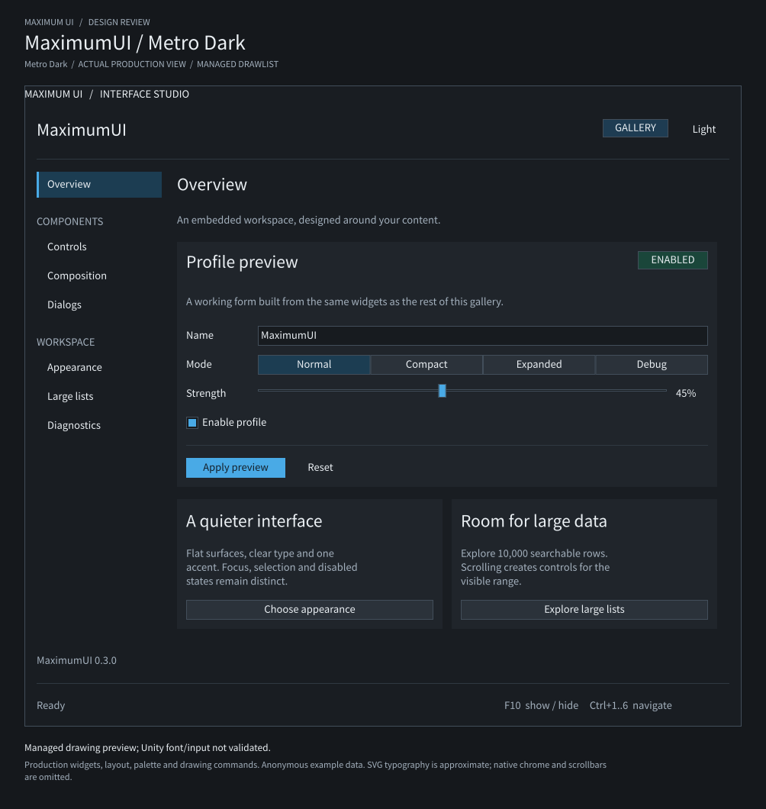
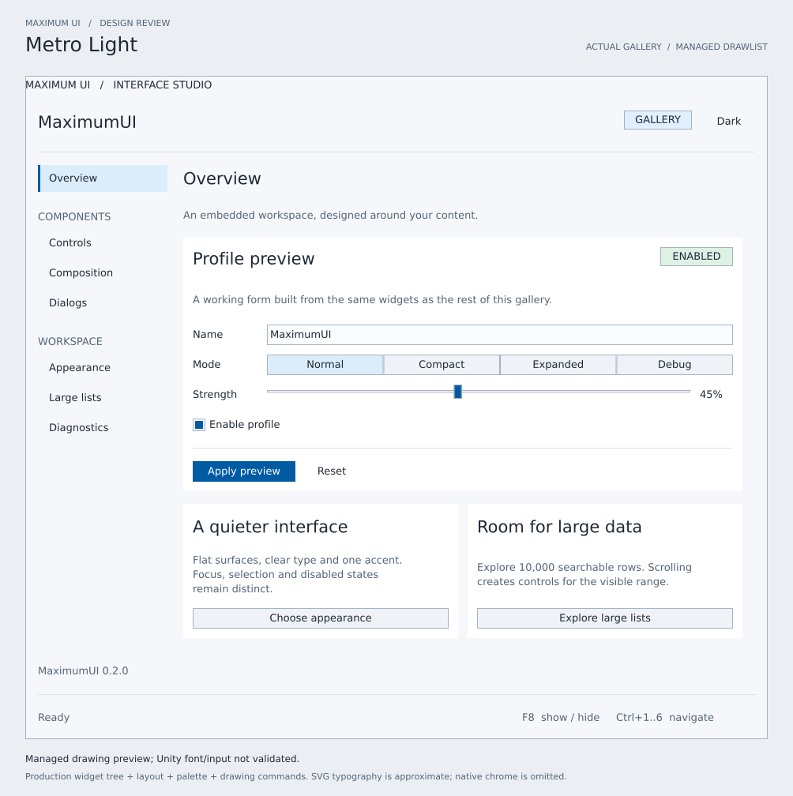

# MaximumUI managed drawing previews

This independent .NET 9 tool produces the review images from **the real Gallery assembly**, not a separately authored mockup. It has no NuGet packages and is excluded from plugin deployment and the solution's release artifacts.

- [Metro Dark](../../docs/maximumui-metro-dark-preview.svg)
- [Metro Light](../../docs/maximumui-metro-light-preview.svg)





## Regenerate

Run from the repository root with the .NET 9 SDK available as `dotnet`:

```sh
dotnet build src/MaximumUIGallery/MaximumUIGallery.csproj -c Release -m:1 -nodeReuse:false
dotnet build src/MaximumUI.Tests/MaximumUI.Tests.csproj -c Release -m:1 -nodeReuse:false
dotnet build tests/MaximumUI.Preview/MaximumUI.Preview.csproj -c Release -m:1 -nodeReuse:false
dotnet run --project tests/MaximumUI.Preview/MaximumUI.Preview.csproj -c Release --no-build -- bin/Release/MaximumUIGallery/KK_MaximumUIGallery.dll docs
```

The second command supplies the existing Unity compilation reference, exactly as the managed benchmark host does. The exporter does not run Unity code. Alternative references can be passed as `-p:MaximumUiAssembly=/absolute/path/to/MaximumUI.dll` and `-p:UnityEngineAssembly=/absolute/path/to/UnityEngine.dll` when building the exporter. Use the matching Gallery assembly when running it.

The output is deterministic for the same assemblies. No timestamp, machine path, screenshot, downloaded artwork, or embedded font is included. An SVG-capable viewer is sufficient; Inkscape can optionally rasterize a file for review:

```sh
inkscape docs/maximumui-metro-dark-preview.svg --export-type=png --export-filename=/tmp/maximumui-metro-dark-preview.png
```

## What is actually exercised

1. Load `KK_MaximumUIGallery.dll` and create its internal `GalleryView` by reflection. Call its production `Build(new BuildContext())` at the default **Overview** page. Only the state's theme name and editable palette differ between the two images; the UI tree is not reconstructed in this tool.
2. Pass that tree to the production `LayoutEngine` with explicit managed text estimates, then to the production `WidgetPainter` with `ThemePalettes.MetroDark()` or `MetroLight()`.
3. Translate the resulting `DrawList` commands into SVG primitives. All control rectangles, panel geometry, navigation selection marks, colors, content strings and ordering come from that pipeline. The exporter does not duplicate widget layout or drawing algorithms.
4. Obtain label roles, wrapping and control text alignment from the actual layout tree. The SVG backend uses a 13 px body font and 21 px heading font with a local Segoe UI / DejaVu Sans / sans-serif fallback. These are estimates, not native `GUIStyle` glyph measurements.

The current Overview produces **64 layout nodes and 75 drawing commands** per theme. Export fails on nonfinite or negative layout geometry, visible content outside the preview window, an unexpectedly missing Overview heading/primary action/selected navigation item, unbalanced clipping commands, an unsupported command, or an invalid saved SVG. Native textures are explicitly unsupported instead of replaced with invented placeholder graphics.

## Scope of the visual evidence

Every output visibly states **“Managed drawing preview; Unity font/input not validated.”** It is not a Koikatsu screenshot.

The window is laid out at **940 × 840**, an allowed resized Gallery size, so the whole Overview fits without scrolling. The Gallery normally opens at 940 × 720. `WidgetPainter` is the managed drawing backend; native window chrome, themed scrollbars, text editing, focus navigation, modal input capture and animation belong to the IMGUI runtime and are not represented or tested by this exporter. No native `MaximumTheme`, `GUIStyle`, game host, mount lifecycle or callbacks are executed.

The generated SVGs have been rasterized and visually checked for legible hierarchy, text/card overlap and dark/light palette consistency. This verifies the exported drawings only. Test the same Gallery inside Unity/Koikatsu to validate native fonts, clipping, scrolling and interaction.
